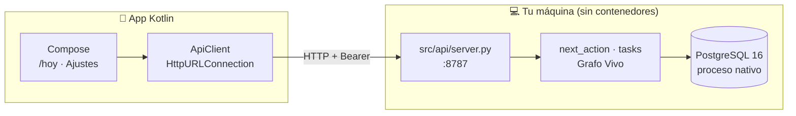

# ANDROID.md — Cliente Kotlin nativo

> Reemplaza a Telegram como interfaz principal. El backend **no** se reescribió:
> la app habla con `src/api/server.py`, que reutiliza `next_action`, `tasks` y
> el Grafo Vivo tal como estaban.

---

## Arquitectura



**Sin Docker.** Postgres corre como proceso nativo; los contenedores se
eliminaron del repo el 2026-10-26.

## Las API keys: nunca van a la app

Esta es la pregunta central, y la respuesta corta es **hay un servidor**.

| Opción | Veredicto |
|---|---|
| La app pide un login OAuth de Gemini/DeepSeek | ❌ ninguno de los dos ofrece OAuth de usuario final para uso personal |
| Embeber la API key en el APK | ❌ un APK es un zip: cualquiera la extrae en 30 segundos |
| **La key vive en el `.env` del servidor** | ✅ **elegido** |

La app solo guarda **dos cosas**: la URL del backend y un token de dispositivo
que genera el servidor (`API_TOKEN`). Si el teléfono se pierde, revocás el token
y no hay nada más que rotar.

```
# .env del servidor (nunca en el repo)
GEMINI_API_KEY=...
DEEPSEEK_API_KEY=...
API_TOKEN=<random>
API_PORT=8787
```

## Cómo se prueba (y el problema del emulador)

**Hecho verificado en este entorno (WSL2):**

| Paso | Estado |
|---|---|
| JDK 21 (Temurin, sin sudo) | ✅ `~/.local/opt/jdk-21.0.13+9` |
| Android SDK 35 + build-tools 35 | ✅ `~/Android/Sdk` |
| `gradlew` 8.11.1 | ✅ |
| Compilación del APK | ✅ `app-debug.apk` (9.1 MB) |
| API local responde, auth 401 sin token | ✅ |

**Bloqueante del emulador:**

```bash
ls /dev/kvm        → No such file or directory
flags vmx/svm      → 0
```

WSL2 no expone virtualización anidada, así que **el emulador no arranca acá**.
Tres salidas, en orden de comodidad:

1. **Emulador de Android Studio en Windows** (nativo, con Hyper-V).
   Apuntá la app a la IP de WSL, no a `10.0.2.2`
   (`wsl hostname -I | awk '{print $1}'`), y arrancá la API con `API_HOST=0.0.0.0`.
2. **Teléfono físico por USB** (requiere `usbipd` en Windows para pasar el
   dispositivo a WSL, o usar `adb` desde Windows). `adb devices` en la terminal
   de Windows, `./gradlew :app:installDebug` con el SDK de Windows.
3. **Un dispositivo virtual en la nube** (Firebase Test Lab, Genymotion Cloud).
   Útil para CI, incómodo para iterar.

Con el emulador en Windows, `10.0.2.2` es el host *de Windows*. Si la API corre
en WSL, la URL correcta es la IP de WSL (`http://<ip-wsl>:8787`).

## Instalar y usar

```bash
# Terminal 1 — backend
source .venv/bin/activate
API_TOKEN=dev-token python3 -m src.api.server

# Terminal 2 — APK
cd android && ./gradlew :app:installDebug
```

En la app: **Ajustes** → URL (`http://<host>:8787`) → token → Guardar →
**Hoy** → Actualizar.

## Estructura

```
android/
├── settings.gradle.kts
├── build.gradle.kts
├── gradle.properties
├── gradlew + gradle/wrapper/
├── local.properties          # sdk.dir (no commiteable)
└── app/
    ├── build.gradle.kts
    └── src/main/
        ├── AndroidManifest.xml
        ├── res/xml/network_security_config.xml
        └── java/com/btcore/taskmanager/
            ├── MainActivity.kt          # 2 pestañas: Hoy · Ajustes
            ├── data/ApiClient.kt        # HTTP + Bearer
            ├── data/Models.kt           # parseo de /hoy
            ├── data/SettingsStore.kt    # URL + token
            └── ui/TodayScreen.kt        # las dos tarjetas
                ui/SettingsScreen.kt
                ui/Theme.kt
```

## Qué falta del MVP

| Ítem | Nota |
|---|---|
| Captura por foto/voz en la app | La API ya tiene `/tasks`; falta cámara (`ActivityResultContracts`) y subir el archivo |
| `/list` con edición | Endpoint existe; falta pantalla |
| Persistencia del historial de `/hoy` | Hoy se re-consulta; cachear en Room es lo natural |
| Push de recordatorios | Hoy el heartbeat imprime a stderr; la app debe consultar |
| TLS propio | `cleartextTrafficPermitted="true"` es aceptable solo en LAN |

## Qué NO se tocó

`src/processing/*`, `src/knowledge/*`, `src/shared/*`, `src/common.py`,
`db/schema.sql`. Todo el Grafo Vivo, `next_action` v1 con los dos slots, la
tabla `decisions` y los 28 tests siguen igual. La app es una vista nueva sobre
los mismos contratos JSON.
