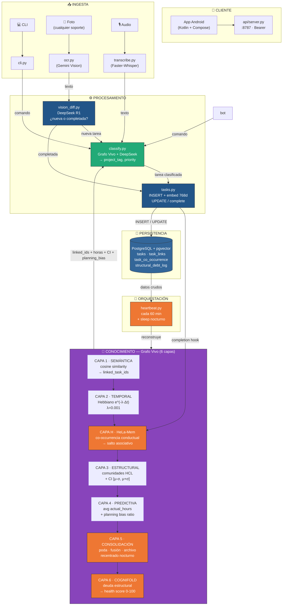

# BT-Core: TaskManager — Arquitectura

> **Stack:** Gemini 2.5 Flash Lite (Vision) + DeepSeek V4-Flash (razonamiento)  
> **DB:** PostgreSQL 16 + pgvector (768d canónico)  
> **Grafo Vivo:** 6 capas (Semántica → Temporal → HeLa-Mem → Estructural → Predictiva → CogniFold)

## Arquitectura de Capas



## Ciclo Virtuoso

`tasks → PostgreSQL → heartbeat → Grafo Vivo → classify`. Cada iteración refina
predicciones con datos reales (planning bias) y patrones conductuales (HeLa-Mem).

## Estructura

```
TaskManager/
├── db/schema.sql              # PostgreSQL + pgvector + decisions + debt_log
│
├── src/
│   ├── common.py              # SSOT: pool DB + Gemini + DeepSeek REST
│   ├── ingest/                # INGESTA
│   │   ├── bot.py             #   Telegram bot determinista
│   │   ├── cli.py             #   CLI router
│   │   └── heartbeat.py       #   Orquestador 60min + sleep nocturno
│   ├── processing/            # PROCESAMIENTO
│   │   ├── classify.py        #   Grafo Vivo + DeepSeek
│   │   ├── vision_diff.py     #   DeepSeek R1 diff lógico
│   │   └── tasks.py           #   CRUD + embed + dedup
│   ├── knowledge/             # CONOCIMIENTO — Grafo Vivo 6-capas
│   │   ├── graph.py           #   Motor: 6 capas + run_full_cycle
│   │   ├── co_occurrence.py   #   HeLa-Mem: co-ocurrencia conductual
│   │   └── embeddings.py      #   Ollama → 768d → pgvector
│   └── shared/                # UTILIDADES
│       ├── ocr.py             #   Gemini VLM
│       ├── transcribe.py      #   Faster-Whisper
│       └── export_md.py       #   Markdown dashboard
│
├── tests/
│   └── stress_test_grafo_vivo.py  # 11 fases de validación
└── scripts/setup_loq.sh
```

## Stack de IA

| Capa | Motor | Rol |
|---|---|---|
| Vision | Gemini 2.5 Flash Lite | OCR pizarras, recibos |
| Razonamiento | DeepSeek V4-Flash | project_tag + priority |
| Diff Lógico | DeepSeek R1 | Vision Diff |
| Audio | Faster-Whisper | Transcripción local |
| Embeddings | nomic-embed-text (Ollama) | Vectores 768d |
| Grafo Vivo | Python + pgvector + scipy | 6 capas de conocimiento |

## Las 6 capas del Grafo Vivo

| # | Capa | ¿Qué hace? | Output |
|---|---|---|---|
| **1** | Semántica | Cosine similarity pgvector | `linked_task_ids` (top-5 vecinos) |
| **2** | Temporal | Decaimiento Hebbiano `e^(-λ·Δt)` | Peso temporal por antigüedad |
| **H** | **HeLa-Mem** | Co-ocurrencia conductual | Peso por hábitos (misma sesión, secuencia) |
| **3** | Estructural | HCL average-linkage | Comunidades + intervalos de confianza `[μ-σ, μ+σ]` |
| **4** | Predictiva | `avg actual_hours` por cluster | `estimated_hours` + ratio planificación |
| **5** | **Consolidación** | Poda (w<0.1), fusión (Jaccard>0.5), archivado (>90d) | Grafo limpio y eficiente |
| **6** | **CogniFold** | 4 deudas estructurales | Health Score 0–100 |

### Peso combinado (3 factores)

```
w = 0.55 × cosine_sim + 0.30 × e^(-λ·Δt) + 0.15 × cooc_score
```

| Símbolo | Peso | Significado |
|---|---|---|
| `β_sem` | 0.55 | Similitud semántica (embedding) |
| `β_temp` | 0.30 | Relevancia temporal (decaimiento) |
| `β_cooc` | 0.15 | Patrón conductual (HeLa-Mem) |

## ¿Cómo funciona el feedback?

1. **Creás tarea** → `classify.py` consulta Grafo Vivo → recibe `linked_ids` (Capa 1) + `estimated_hours` con `[CI_lower, CI_upper]` (Capa 4) + `planning_bias` del proyecto → DeepSeek solo decide `project_tag` + `priority` → `tasks.py` INSERT.

2. **Completás tarea** → `tasks.py complete --hours X` → `actual_hours` + `last_activity_at` se persisten → hook dispara `record_completion()` para HeLa-Mem.

3. **Heartbeat (60 min)** → `graph.py` actualiza co-ocurrencia (Capa H), links semánticos (Capa 1), pesos temporales (Capa 2), comunidades con CI (Capa 3), planning ratios (Capa 4).

4. **Sleep (nocturno)** → `consolidate_sleep()` poda links muertos, fusiona comunidades solapadas, archiva tareas inactivas >90 días, recentra pesos. Corre `structural_debt_report()` para el dashboard CogniFold.

5. **Próxima tarea** → `classify.py` recibe datos MÁS precisos + patrón conductual → el ciclo se refuerza.

## Hiperparámetros

| Parámetro | Valor | Significado |
|---|---|---|
| λ (lambda) | 0.001 | Decaimiento temporal (vida media ~29 días) |
| β_sem | 0.55 | Peso semántico en combined_weight |
| β_temp | 0.30 | Peso temporal en combined_weight |
| β_cooc | 0.15 | Peso co-ocurrencia (HeLa-Mem) |
| TOP_K | 5 | Vecinos máximos por tarea |
| Cohesión mínima | 0.6 | Para promover cluster a subproyecto |
| Tamaño mínimo | 5 | Tareas mínimas para subproyecto |
| PRUNE_THRESHOLD | 0.1 | Peso mínimo para mantener un link |
| MERGE_JACCARD | 0.5 | Solapamiento para fusionar comunidades |
| ARCHIVE_DAYS | 90 | Inactividad para archivado automático |

## Deuda Estructural (CogniFold)

| Métrica | Significado | Alerta |
|---|---|---|
| **Huérfanas** | % tareas sin links | >20% → problema de embeddings |
| **Dead links** | % links con weight < 0.1 | >30% → λ muy agresivo |
| **Fragmentación** | ratio comunidades/tareas | >50% → umbral de clustering muy estricto |
| **Densidad** | links existentes / posibles | <10% → grafo muy disperso |
| **Health Score** | 0–100 combinado | <60 → requiere intervención |
