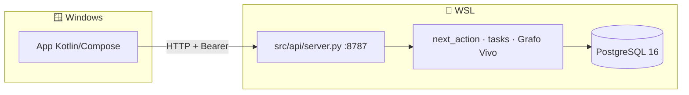

# HANDOFF — Continuar en VS Code (Windows) con nueva sesión de Copilot

> **Fecha:** 2026-10-26
> **Para:** nueva sesión de Copilot en VS Code **de Windows**.
> **Sesión anterior:** trabajó desde WSL (`/home/trigueros/...`), ya cerrada.

---

## 0. Léeme primero, en 30 segundos

Este proyecto **ya funciona end-to-end**. No hace falta rediseñar nada.
Lo que falta es terminar el cliente Android, que por fin tiene toolchain operativo.

**Tres cosas que NO hay que rehacer:**

1. El Grafo Vivo de 6 capas — cableado y verificado.
2. `next_action` v1 con los dos slots — 28 tests pasando.
3. La API HTTP local — responde `health: db up`.

**La trampa principal:** no intentes correr Postgres ni Python *desde Windows*.
El backend vive en WSL y ya está instalado. Desde Windows solo se consume por
HTTP en `localhost:8787`.

---

## 1. Layout del workspace

```
C:\Users\trigueros\Dev\TaskManager\        ← repositorio completo
├── src/                                  # backend Python (se lee, no se ejecuta acá)
├── db/schema.sql
├── android/                              # ✅ acá se compila y se corre
├── PRODUCT.md                            # 🎯 el norte — leer antes de tocar código
├── DESIGN.md
├── ARCHITECTURE.md
├── ANDROID.md
├── HANDOFF.md                            # este archivo
└── tests/
```

| Componente | Dónde corre | Cómo |
|---|---|---|
| PostgreSQL 16 | **WSL** | servicio systemd, ya instalado |
| API (`src/api/server.py`) | **WSL** | `python3 -m src.api.server` |
| App Android | **Windows** | Android Studio / VS Code + emulador |

**El teléfono (emulador) habla con WSL por HTTP.** Nada más los une.

---

## 2. Estado verificado (no asumir, ya se probó)

| Componente | Estado | Evidencia |
|---|---|---|
| PostgreSQL 16 + pgvector | ✅ | `health: db up` |
| Grafo Vivo (6 capas) | ✅ | 30 links, 2 comunidades, health 96.7 |
| `next_action` v1 | ✅ | 2 slots, decisión persistida en `decisions` |
| Tests | ✅ | 28/28 en `tests/test_next_action.py` |
| Datos en la base | ✅ | 8 tareas, 8 decisiones |
| API HTTP | ✅ | `/health`, `/hoy`, `/tasks`, `/decisions/{id}/close` |
| APK compila | ✅ | `app-debug.apk`, 9.1 MB, con JDK 21 |
| Gemini API | ✅ | HTTP 200 |
| DeepSeek API | ✅ | key regenerada, clasifica bien |

---

## 3. Primeros pasos — en este orden

### 3.1 Arrancar el backend (WSL) — **terminal aparte, dejarla abierta**

Abrí una terminal WSL (no PowerShell):

```bash
cd ~/Dev/FigureThisOut/TaskManager
source .venv/bin/activate
python3 -m src.api.server
```

Esperado:
```
[api] escuchando en http://0.0.0.0:8787 (auth: token)
```

Verificar desde **PowerShell**:
```powershell
curl http://localhost:8787/health
# {"ok": true, "service": "taskmanager-api", "db": "up"}
```

> Si el puerto está ocupado: `pkill -f src.api.server` y reintentar.

### 3.2 Abrir el workspace en VS Code (Windows)

`File → Open Folder` → `C:\Users\trigueros\Dev\TaskManager`

### 3.3 Instalar extensiones (VS Code Windows — son builds distintas)

```
fwcd.kotlin
vscjava.vscode-java-pack
vscjava.vscode-gradle
```

> Las extensiones instaladas en WSL **no se heredan**. Windows necesita las suyas
> (`win32-x64`).

### 3.4 Verificar JDK

`.vscode/settings.json` apunta a un JDK de **Linux**
(`/home/trigueros/.local/opt/jdk-21...`), ruta que **no existe en Windows**.
Hay que cambiarla:

| Opción | Ruta |
|---|---|
| Android Studio trae uno | `C:\Program Files\Android\Android Studio\jbr` |
| Temurin 21 | `C:\Program Files\Eclipse Adoptium\jdk-21...` |
| Si no hay ninguno | Instalar [Temurin 21](https://adoptium.net/temurin/releases/?version=21) |

Editar `.vscode/settings.json`:
```json
"java.jdt.ls.java.home": "C:\\Program Files\\Android\\Android Studio\\jbr",
"java.import.gradle.java.home": "C:\\Program Files\\Android\\Android Studio\\jbr"
```

> **No usar Java 25**: Gradle 8.11.1 falla con
> `Unsupported class file major version 69`.

### 3.5 Abrir `android/` y esperar el sync

`File → Open Folder` → `...\TaskManager\android` (workspace aparte o multi-root).

Gradle sincroniza y descarga AGP + Compose BOM (3-8 min la primera vez).

### 3.6 Emulador + Run

**Android Studio** (recomendado para gestionar el AVD):
`Device Manager` → Pixel 7 → API 35 → ▶️

O por línea de comandos:
```powershell
cd C:\Users\trigueros\Dev\TaskManager\android
.\gradlew.bat :app:installDebug
```

### 3.7 Configurar la app

Dentro del emulador, pestaña **Ajustes**:

| Campo | Valor |
|---|---|
| URL | `http://localhost:8787` |
| Token | ver `API_TOKEN` en el `.env` de WSL |

El token se lee así (terminal WSL):
```bash
grep '^API_TOKEN=' ~/Dev/FigureThisOut/TaskManager/.env
```

**Por qué `localhost`:** `networkingMode=mirrored` está activo en
`C:\Users\trigueros\.wslconfig`, así WSL comparte la red de Windows.
Fallback: `http://192.168.1.70:8787`.

Después: **Guardar** → pestaña **Hoy** → **Actualizar**.

---

## 4. Arquitectura que hay que respetar



**Reglas:**

1. Las API keys (Gemini/DeepSeek) **nunca** salen del `.env` de WSL. La app solo
   tiene URL + token de dispositivo.
2. El backend **no** se reescribe. La app es una vista sobre contratos JSON ya
   existentes.
3. Todo módulo Python imprime JSON a stdout y es ejecutable con `python3 -m`.

---

## 5. Concepto clave: qué decide el sistema

`next_action.py` devuelve **dos propuestas**, no una lista:

| Slot | Candidatas | Fórmula |
|---|---|---|
| ⚡ **quick** | ≤ 0.75 h o sin estimación | `score(E,V,D) × quick_weight(h)` |
| 🧠 **deep** | ≥ 1.5 h | `valor × urgencia × (0.5 + 0.5·E)` |

```
score = (E × V) / (1 + I × D/30) × bonus_vencida
E     = 1 / (1 + |planning_ratio - 1|)     # calibración del cluster (Capa 4)
V     = prioridad / 5
D     = días hasta vencimiento (sin fecha → 15)
bonus_vencida = 1 + 0.5 · e^(-edad/10)     # decae
```

**Tres sesgos ya corregidos** (no reintroducirlos):

1. **Bucle de culpa** — un bonus fijo hacía que lo atrasado dominara siempre.
2. **Lo trivial gana** — sin slots, "revisar correo" (0.3 h) le ganaba a
   "entrenar modelo" (6 h).
3. **Trampa de evitación** — el trabajo importante tiene `expectancy` baja porque
   lo evitás; `deep_score` atenúa ese factor al 50 %.

---

## 6. Deuda técnica conocida

| Ítem | Impacto | Nota |
|---|---|---|
| `quick` puede elegir de una bolsa de 1 | Propone algo irrelevante | Debería decir "sin arranque corto hoy" |
| `estimate_range: null` sin explicar | La app no comunica "sin historial" | Falta badge en la tarjeta |
| Sin captura por foto/voz en la app | Endpoint `/tasks` existe | Falta cámara + subida |
| Sin push de recordatorios | `heartbeat` imprime a stderr | La app debería consultar |
| `local.properties` con ruta Linux | Android Studio lo regenera | Borrarlo si molesta |

---

## 7. Comandos útiles (terminal WSL)

```bash
cd ~/Dev/FigureThisOut/TaskManager && source .venv/bin/activate

# Decisión sin base de datos (corpus de 30 tareas)
python3 -m src.processing.next_action --demo

# Ciclo del grafo
python3 -m src.ingest.heartbeat --action graph

# Clasificar
python3 -m src.processing.classify "terminar el lab 5"

# Tests
python3 tests/test_next_action.py
```

---

## 8. Contexto de producto (leer antes de proponer features)

`PRODUCT.md` es el documento canónico. Resumen:

> **El único sistema que olvida a propósito.**
> Output = **una decisión al día**, no una lista.
> Promesa: decidir en 30 segundos con evidencia de tu propia historia.

**Regla dura:** si el resultado no se puede *importar*, no se puede aprender.
Reportar horas manualmente es el impuesto que mata al producto.

**Fase actual: M1 — "una decisión al día".**
Criterios de kill a 14 días: abierto ≥10/14 · ejecutado ≥50 % · error de
duración ≤60 %. Si no llega a 10/14, el problema es el **output**, y no se avanza
a M2.

**No hacer:** otro Notion/Obsidian, más canales de captura, generalizar sin
dominio de salida, multi-usuario antes de 14 días de uso propio.

---

## 9. Lo que quedó sin commitear

Todos los cambios desde `87ed157` están en el working tree de WSL
(`~/Dev/FigureThisOut/TaskManager`). La copia en Windows los incluye, pero **no
es un repo git**.

Si hay que commitear, hacerlo **desde WSL**:

```bash
cd ~/Dev/FigureThisOut/TaskManager
git add -A && git commit
```

Pendiente sugerido: separar en `feat(android)`, `chore(remove-telegram-docker)`
y `docs(product)`.

---

## 10. Regla de oro para la nueva sesión

**Antes de escribir código, leer `PRODUCT.md`.**

El backend está terminado y probado. El riesgo real no es técnico: es agregar
features que no sirven al norte (otra vista, otro canal de captura, otra métrica)
y diluir el producto. Si una propuesta no hace que alguien abra la app 14 días
seguidos, no es prioridad.
