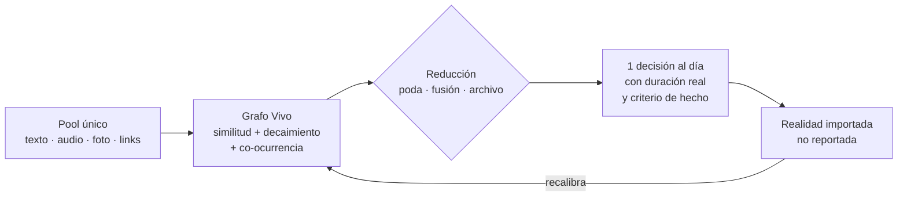

# PRODUCT.md — Norte del producto

> **Documento vivo.** Toda decisión de código se contrasta contra este archivo.
> Última revisión: 2026-10-26
>
> Complementa a [DESIGN.md](DESIGN.md) (cómo está construido) y
> [ARCHITECTURE.md](ARCHITECTURE.md) (mecanismo del Grafo Vivo).

---

## 1. Diagnóstico

El backend está bien. El producto, no.

Como **gestor de tareas** no es para otras personas: los casos de diseño
salieron de un usuario (UCR, HPE, pizarrón) y no sobreviven a un usuario nuevo.
Como **motor de decisión sobre señal heterogénea**, en cambio, tiene piezas que
casi nadie tiene.

Cinco razones por las que hoy es un burden:

1. **Doble inbox.** Telegram + CLI + Obsidian: tres lugares más donde mirar.
2. **Recompensa invertida.** El grafo no devuelve nada hasta ~30-50 unidades.
   Las primeras dos semanas son puro costo.
3. **El aprendizaje depende de trabajo humano.** `complete --hours 6` es el
   corazón del loop y requiere que el usuario audite su propio comportamiento.
   Todo sistema con esa dependencia muere en la semana 3.
4. **El schema fuerza compromiso prematuro.** `estimated_hours`, `due_date`,
   `priority` convierten una idea o una referencia en una tarea que nunca se
   hará, y eso ensucia el grafo.
5. **Una lista no decide.** `/tablero` muestra 15 cosas. El problema nunca fue
   verlas, fue elegir.

## 2. La tesis

> **El único sistema que olvida a propósito.**

Todo el mundo construye almacenes. Este ya sabe **podar, fusionar y archivar**
(Capa 5) — y eso, que hoy es una capa técnica, debe ser **la promesa del
producto**: *"tus 4.000 guardados, reducidos a las 12 cosas que importan este
mes"*.

El surface no es un lugar donde se navega. Es un **evento**:



**Promesa en una línea:** *"Decidí en 30 segundos qué hacer ahora, con evidencia
de tu propia historia."*

## 3. Las tres reglas no negociables

1. **Un solo inbox.** No se agregan canales de captura; se quitan.
2. **Una sola pregunta por unidad**, con tres opciones:
   `acción` · `referencia` · `ruido`. Ese es todo el entrenamiento que se le
   pide al humano.
3. **Un solo output**: la próxima acción, con duración estimada de la historia
   del usuario y una definición de "hecho" de una línea.

## 4. Modelo de unidad

`tasks` deja de ser el modelo y pasa a ser **una proyección**.

| `kind` | Qué es | Tiene decisión | Tiene resultado |
|---|---|---|---|
| `action` | algo que se ejecuta | ✅ | ✅ (horas / estado) |
| `reference` | algo que se consume (paper, charla, link) | ❌ | 🟡 (recuperación) |
| `signal` | algo que informa (dato, evento, mensaje) | ❌ | ❌ |

El grafo no sabe ni le importa qué son los nodos. Esa es la ventaja: **el
backend ya está escrito para unidades anónimas**.

## 5. Teoría → mecánica → qué ya existe

| Teoría | Mecánica de producto | Estado |
|---|---|---|
| **TMT de Steel** — Motivación = (Expectativa × Valor) / (1 + Impulsividad × Demora) | Mostrar expectativa y acortar la demora | ✅ `avg_actual_hours` + CI |
| **Autoeficacia (Bandura)** | Éxitos pasados del cluster visibles al elegir | ✅ comunidades + `planning_bias` |
| **Intenciones de implementación (Gollwitzer)** | El sistema redacta el "si X entonces Y" | ❌ falta |
| **Próxima acción (GTD)** | Partir hasta que el primer paso dure <2 min | ❌ falta |
| **Deep work (Newport)** | Bloque propuesto en el calendario, no en una lista | ❌ falta |
| **Práctica deliberada (Ericsson)** | Dificultad al borde: proponer dentro del CI | ✅ CI por cluster |
| **Repetición espaciada (FSRS)** | Re-surfacear por decaimiento, no por fecha fija | ✅ Capa 2 (λ) |
| **Zeigarnik + regla de 2 min** | Arrancar con el primer micro-paso ya escrito | ❌ falta |
| **Ritual de cierre** | Consolidación nocturna + "3 para mañana" | ✅ `consolidate_sleep` |

Patrón: **están las piezas difíciles (expectativa calibrada, decaimiento,
clustering) y faltan las baratas (redactar el primer paso, agendar, importar
realidad).**

## 6. Criterio de señal de resultado

> **Si el sistema no puede importar la realidad, no puede aprender.**
> Reportar es el impuesto que mata al producto.

| Unidad | Señal de resultado | Costo |
|---|---|---|
| Tarea | reportar horas | 🔴 humano, cada vez |
| **Dinero** | extracto bancario importado | 🟢 gratis |
| **Código** | commit / PR mergeado | 🟢 gratis |
| **Postulaciones** | respuesta en el mail | 🟢 gratis |
| Calendario | tiempo real vs. plan | 🟡 semi |
| Lectura / estudio | quiz de recuperación | 🟡 |
| Idea / referencia | — | 🔴 no debe ser unidad de decisión |

## 7. Roadmap

### M0 — Fundación ✅ (2026-10-26)

- Las 6 capas del Grafo Vivo cableadas al heartbeat (`run_full_cycle`)
- `numpy` + `scipy` declarados en `requirements.txt`
- Consolidación diaria vía `HEARTBEAT_SLEEP_HOUR`

**Estado:** hecho y verificado estáticamente.

### M1 — Una decisión al día ← **EMPIEZA ACÁ**

El único objetivo: que abrir el sistema devuelva **una** decisión, no una lista.

**Alcance:**

1. `src/processing/next_action.py` — calcula **una** unidad:
   ```
   score = (expectancy × value) / (1 + impulsividad × demora)

   expectancy = f(avg_actual_hours del cluster, CI)   # capa 4
   value      = priority normalizada
   demora     = horas hasta due_date (∞ → penaliza por staleness)
   impulsividad = constante configurable (default 1.0)
   ```
   Devuelve además: por qué la eligió, duración esperada con rango, y un
   **primer paso de 2 minutos**.
2. Bot: `/hoy` → un mensaje, una acción, con botones
   `[Hecho]` / `[Hoy no]`.
3. **Cierre en un tap**: `[Hecho]` abre horas pre-cargadas desde la estimación
   del cluster (`¿~3h?` `[3h]` `[más]` `[menos]`). Costo de cierre ≈ 0.
4. Registrar cada decisión en una tabla `decisions` (`unit_id`, `score`,
   `chosen_at`, `executed`, `actual_hours`) — es la materia prima de la
   calibración futura.

**Fórmula v0:** es una aproximación. Se calibra con datos de `decisions`, no
antes.

**Criterios de aceptación (14 días):**

| Métrica | Umbral |
|---|---|
| Días con `/hoy` abierto | ≥ 10 / 14 |
| Acciones ejecutadas sobre propuestas | ≥ 50 % |
| Error absoluto de la duración estimada | ≤ 60 % |

**Regla de kill:** si no se llega a 10/14 días, el problema es el **output**.
No se avanza a M2 hasta resolverlo.

### M2 — Unidad generalizada

- Columna `kind` (`action | reference | signal`) y tabla `units`
- `tasks` pasa a ser vista/proyección de `units WHERE kind='action'`
- Captura con un solo gesto + la pregunta de 3 opciones

**Go:** 30 unidades heterogéneas capturadas sin fricción y al menos una
referencia re-surfaceada sola por decaimiento.

### M3 — Realidad importada

- Un conector, uno solo: **dinero** (`reconcile.py` ya existe) o **mail**
  (respuestas de postulaciones)
- El outcome entra sin intervención humana

**Go:** >50 % de las unidades de decisión con resultado automático.

### M4 — Bloque de tiempo

- Integración con calendario (bloque propuesto, no lista)
- Intención de implementación redactada por el sistema
- Ritual de cierre nocturno con "3 para mañana"

## 8. Qué NO hacer

1. **No construir "un Notion/Obsidian mejor".** Cementerio: captura barata,
   retorno nulo.
2. **No agregar canales de captura.** Cada canal nuevo es superficie sin valor.
3. **No generalizar sin elegir un dominio de salida.** "Ordenar todo el media
   de internet" es un no-producto: el cuello de botella no es ordenar lo
   guardado, es tener un motivo para volver.
4. **No ir a multi-usuario** antes de que un usuario lo abra 14 días seguidos.

## 9. Qué NO cambia del backend

Embeddings 768d, pgvector, las 6 capas, consolidación, contratos JSON a stdout,
enfoque determinista. El rediseño de producto es ~20 % de código: tipo de
unidad, ingesta de resultado y superficie de decisión.
